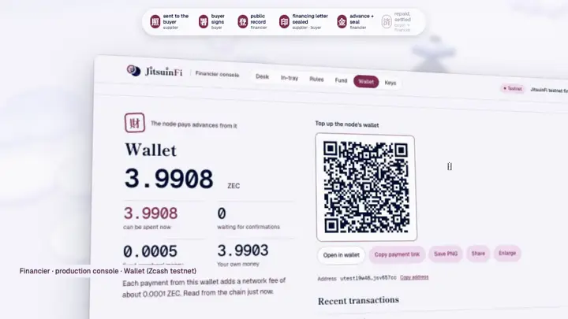
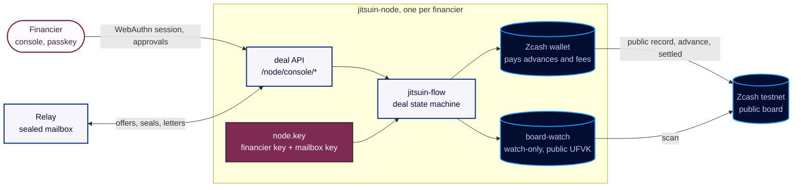
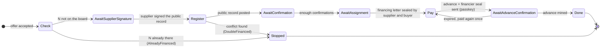
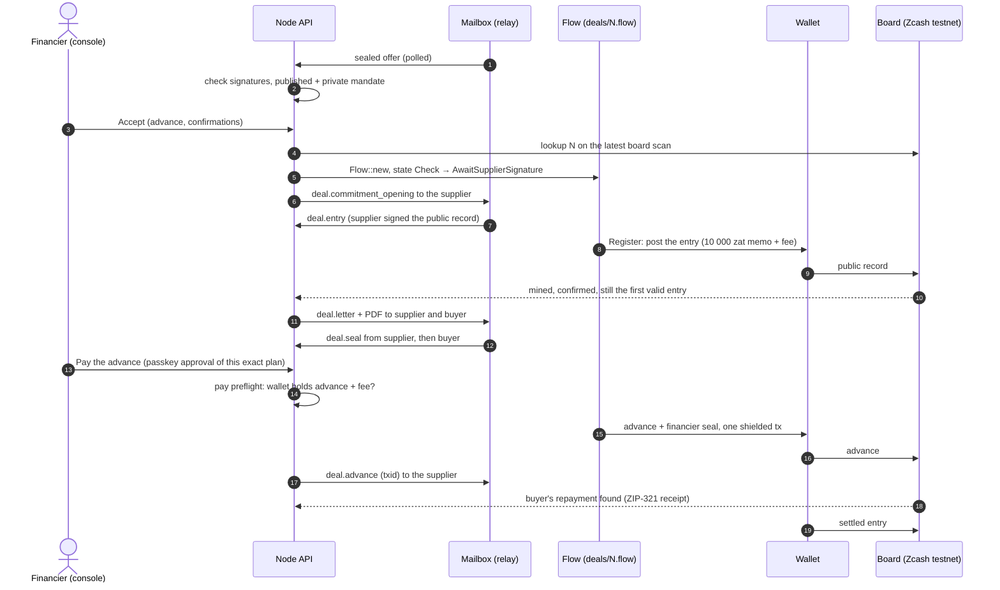
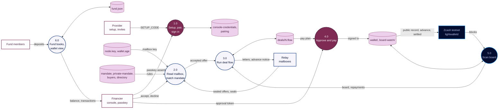

  

  
  
  
  
  

  <b>A financier's node: its keys, its Zcash wallet, the board it checks, its sealed mailbox, its console and the deal API.</b>

  <a href="https://jitsuinfi.vercel.app"><b>Landing</b></a> ·
  <a href="https://jitsuinfi.vercel.app/app"><b>App</b></a> ·
  <a href="https://jitsuinfi.vercel.app/try"><b>Try to double-finance</b></a> ·
  <a href="https://jitsuinfi.vercel.app/verify"><b>Verify</b></a> ·
  <a href="https://jitsuinfi-console-demo.vercel.app/console"><b>Console demo</b></a> ·
  <a href="https://youtu.be/RB9hKSLarJo"><b>2-min video</b></a>

  
   Two minutes: the idea, a double-financing attempt caught live on the testnet board, and a whole deal from supplier to settlement.

A **JitsuinFi** financier's node (HNK-26): its keys, its Zcash wallet, the board it checks, its relay mailbox, its console and the deal API that console uses ([API](#api-hnk-05t3) below). Built on the `jitsuin-*` crates of `jitsuinfi-zcash`, pinned to a commit.

<table>
  <tr>
    <td width="50%" valign="top"> <b>The console: sealed offer to advance</b> An offer reaches the Desk in about 6 s; the financing letter carries the supplier's 売 and buyer's 買 seals; one passkey touch approves the advance.</td>
    <td width="50%" valign="top"> <b>Wallet: who pays what</b> The node's wallet pays the advance and the network fees (about 0.0001 ZEC each). JitsuinFi never holds anyone's money.</td>
  </tr>
</table>

## Inside the node

**The deal state machine** (`jitsuin_flow::financier::Flow`): money moves only in `Register` (the public record and its fee) and `Pay` (the advance with the financier's seal, in one shielded transaction).

## Flow in this repo (node)

**Sequence: one deal through the node** (`src/deals.rs`, `src/pay.rs`, `jitsuin_flow::financier::Flow`)

**DFD: what the node keeps**

DFD legend: rectangles are external entities, circles are processes, cylinders are data stores; arrows carry the named data.

## Keys
All in the data volume (`DATA_DIR`, `/data` on Railway), never in the repo, the image, a log or an API:
- `node.key` (32 random bytes, mode 0600): the financier's Ed25519 key and its mailbox key are derived from it (BLAKE2b, personalizations `JitsuinNodeFin__`, `JitsuinNodeMbox_`).
- `wallet/` + `wallet.age` (0600): the zcash-devtool spending wallet, its mnemonic encrypted to the age identity.
- `board-watch/`: watch-only wallet of the public board UFVK.
- `pairing.json` (0600): the SHA-256 of a waiting pairing code, while one waits.
- `console-credentials.json` (0600, D9): the console passkeys (public keys only).

`jitsuin-node setup` makes what is missing (HNK-26.T1) and prints only public values; `serve` runs setup, registers the financier mailbox at the relay (HNK-26.T4), then serves `GET /node/health`, `GET /node/info` (financier key, mailbox id, wallet address, contact card) and the console. `jitsuin-node inbox` lists the messages in the mailbox.

## Try it: the demo console (HNK-26.T26, D-46)

<https://jitsuinfi-console-demo.vercel.app/console> runs this node with `DEMO=1` on its own testnet service: anyone creates a passkey without an invite and signs in as its financier. Approvals, devices, invites, names and deleting messages are off there, and only the 200 newest passkeys are kept.

Production: deals on <https://jitsuinfi.vercel.app> run against this node; their testnet txids are in the [jitsuinfi-zcash README](https://github.com/JitsuinFi/jitsuinfi-zcash#for-judges-verify-the-testnet-board) (step 6, "Through the live web app and console").

## Onboarding a financier, no terminal (HNK-26.T20, D-43)
The node is managed by its provider; the financier only uses a browser and a passkey.
1. The provider sets the Railway variable `SETUP_CODE` to a random code (16+ letters or digits, e.g. from a password generator) on the financier's node. `NODE_ORIGIN` comes from `RAILWAY_PUBLIC_DOMAIN` by itself.
2. The provider sends the financier, through a private channel, the invite link `<origin>/console/pair#<SETUP_CODE>`. The part after `#` never reaches a server; the page fills the code in and removes it from the address bar.
3. The financier opens the link, creates a passkey (fingerprint or face), and signs in at `<origin>/console/`.

The setup code pairs the first passkey only; once a passkey is paired it is refused, and five wrong tries lock it for 15 minutes. More devices: **Add a device** in a signed-in console gives a one-time invite link (15 minutes). `jitsuin-node pair` (Railway: `railway ssh --service financier-node jitsuin-node pair`) stays for the provider's recovery only.

## New financiers: apply, review, node (HNK-26.T25, D-46)

The provider's steps

A financier applies at `jitsuinfi.vercel.app/apply`. The application (name, contact, note) is sealed to the provider's mailbox; the relay keeps ciphertext only. The provider, on its own machine:
1. `jitsuin-node provider init` once: makes the provider key in `~/.jitsuin-provider` (0600; back it up) and prints the public mailbox and signing keys the web app carries (`src/lib/provider.ts`).
2. `jitsuin-node provider inbox`: reads the applications. Review is manual (financier KYC is a later task, HNK-26.T27).
3. `scripts/provision-node.sh <service> "<name>" <reply_mailbox_pk>`: makes the Railway service, volume and settings with a random `SETUP_CODE`, then sends the applicant a signed invite sealed to its mailbox. The console origin for a new node is added by hand (a Vercel project and a host rule), as the script says.
4. `jitsuin-node provider remove <relay_id>` clears a handled application.

The applicant checks for the invite on the same page, in the same browser; the page opens only a link signed by the provider key that points to a JitsuinFi console.

## Console pairing and sign-in (HNK-26.T2, T3)

How pairing and sign-in work

1. Set `NODE_ORIGIN` to the node's own HTTPS origin (the Railway domain); its host is the passkey `rp.id`.
2. On the node, run `jitsuin-node pair` (Railway: `railway ssh --service financier-node jitsuin-node pair`). It prints a one-time code, valid for 15 minutes; only its hash is stored, never a log line.
3. Open `<NODE_ORIGIN>/console/pair`, type the code and create the passkey. The node verifies the attestation (challenge, origin, `rpIdHash`, user verification) and keeps the credential.

Then sign in at `<NODE_ORIGIN>/console/` (HNK-26.T3): a one-time challenge (2 minutes), an assertion checked for origin, `rpIdHash`, user verification, signature and counter, then an 8-hour session in a `__Host-jitsuin_console` cookie (`Secure`, `HttpOnly`, `SameSite=Strict`). The node keeps only the SHA-256 of session tokens, in memory.

Signed in, the console lists the financier mailbox through the node (HNK-26.T4): `GET /node/mail` opens the sealed messages with the node's mailbox key and returns their headers; `GET /node/mail/{id}/attachments/{i}` returns a PDF; `DELETE /node/mail/{id}` removes a message at the relay. All three need the session cookie; the removal also needs the console's `Origin`. The browser never holds the mailbox key.

Every advance needs a passkey approval of that payment (HNK-26.T15): `POST /node/console/approve/start` with the intent (N, amount, address) and `/finish` with a fresh assertion give a one-time approval, valid 5 minutes for that payment only; the payment gate (`pay::advance`) uses it up before `Financier::pay_advance`. A session cookie alone cannot pay.

A code is used up on its first correct try and dropped after five wrong ones. The console's POSTs must carry the console's own `Origin`; every response has a same-origin CSP and `frame-ancestors 'none'`.

## Settings

Open the reference

| Variable | Value |
|---|---|
| `BOARD_UFVK` | the public board key (`jitsuinfi-zcash/examples/testnet/board-ufvk.txt`) |
| `BOARD_BIRTHDAY` | `4508703` |
| `NETWORK` | `test` (default) |
| `DATA_DIR` | `/data` (default) |
| `ZCASH_DEVTOOL` | path of zcash-devtool (`/usr/local/bin/zcash-devtool` in the image) |
| `RELAY_URL` | relay base URL (default: the Railway relay) |
| `NODE_ORIGIN` | the console's origin; defaults to `https://$RAILWAY_PUBLIC_DOMAIN` on Railway; without either the console is off |
| `SETUP_CODE` | optional: the provider's code for the first console passkey (invite link `<origin>/console/pair#<code>`) |
| `FINANCIER_NAME` | optional: a first display name for the financier; the financier changes it in the console (Profile), saved in `financier-name.txt` |
| `DEMO` | `1` for the judges' demo console: pairing without an invite, payments, approvals, device removal, invites, name changes and message removal off; each visitor sees only its own passkey; the newest 200 passkeys are kept |
| `PORT` | set by Railway |

## Deploy

Open the reference

CI builds `jitsuin-node` and zcash-devtool on ubuntu-24.04 (zcash-devtool cached by revision) and runs `railway up deploy --service financier-node`: `deploy/Dockerfile` only copies the two binaries, so Railway never compiles. Secrets: `ZCASH_DEPLOY_KEY` (read-only deploy key of `jitsuinfi-zcash`), `RAILWAY_TOKEN` (project token of `jitsuinfi-relay`). The service mounts a Railway Volume at `/data`.

Status: in development for ZECATHON 2026, on Zcash testnet. The spending key is a hot wallet on the server: fine for small testnet amounts; a production financier runs its node on its own infrastructure.

## API (HNK-05.T3)

Open the reference

The console (`/console/`) is the only client. "Session" means the console's signed-in cookie from a passkey sign-in; "write" routes also need the request's `Origin` to be `NODE_ORIGIN`. "Approval" means a fresh passkey assertion over the plan the console shows (`approve/start`, then `approve/finish`), so a stolen session cannot move funds. Errors are `{ "error": "<sentence for the financier>" }` with a 4xx or 5xx status.

| Method | Path | Access | Body | Answer |
|---|---|---|---|---|
| GET | `/node/info` | public | | the node's public keys, wallet address, network |
| GET | `/node/board` | public | | the latest board scan (entries and settled entries, tip height) |
| POST | `/node/console/pair/start`, `/pair/finish` | pairing code | `code`; then `ceremony`, `credential` | passkey registration options; then the session |
| POST | `/node/console/login/start`, `/login/finish` | public | none; then `ceremony`, `credential` | passkey sign-in options; then the session |
| GET | `/node/console/session` | public | | `signed_in`, `paired`, `name`, `console`, `demo` |
| POST | `/node/console/logout` | session | | `ok` |
| POST | `/node/console/name` | session, write | `name` | `ok` |
| GET, POST, DELETE | `/node/console/devices`, `/devices/code`, `/devices/{id}` | session (write for POST and DELETE) | | the passkeys; a one-time code to add a device; removal |
| POST | `/node/console/approve/start`, `/approve/finish` | session, write | `plan`, or the advance's `n`, `amount_zat`, `address`; then `ceremony`, `credential` | the assertion options; then the one-use `approval` token. An advance the wallet cannot pay with the fee is refused first: `409 {error, need_zat, spendable_zat, advance_zat, fee_zat}` |
| GET | `/node/mail` | session | | `messages` (offers, seals, history, fund mail), `refused`; an accepted offer says where the commitment opening is (`opening`: `sent`, `awaiting_history`, `sent_after_history`) |
| DELETE | `/node/mail/{id}` | session, write | | `ok` |
| GET | `/node/mail/{id}/attachments/{index}` | session | | the attachment's bytes (the invoice PDF) |
| POST | `/node/console/offers/{id}/accept` | session, write | `advance_zat`, `min_confirmations` | the new deal; asks the buyer's history first when the private mandate says so |
| POST | `/node/console/offers/{id}/decline` | session, write | `reason` | `ok`; the supplier gets `deal.decline` |
| GET | `/node/console/deals` | session | | `deals`: state, txids, seals, the next step per deal; a stopped deal's `stopped`, `stopped_winner` and `stopped_order` (`ours_first`, `theirs_first`, `others_only`); a deal in Pay also `need_zat` (advance plus fee), `spendable_zat` (last sync, `null` before one) and `wallet_short` |
| POST | `/node/console/deals/{n}/step` | session, write | | the deal after one step of `jitsuin-flow` |
| POST | `/node/console/deals/{n}/pay` | session, write, approval | `approval` | the advance txid; `409` as for `approve/start` when the wallet is short (the approval stays unused) |
| GET | `/node/console/wallet` | session | | the node's wallet: `balance_zat`, `spendable_zat`, `pending_zat`, `fund_cash_zat` and `own_zat` (`null` without a fund), `fee_zat`, `topup_address` and `topup_uri` (one shielded address made once, `wallet-topup.json`), `txs` (newest 30: `txid`, `height`, `delta_zat`, `kind`), `synced_at`; synced at most every 15 s, the last good state when a sync takes over 8 s |
| GET, POST | `/node/console/mandate`, `/mandate/private` | session (write for POST) | the mandate | the published and the private mandate |
| GET, POST, DELETE | `/node/console/buyers`, `/buyers/{pk}` | session (write for POST and DELETE) | `identity_pk`, `label` | the KYC list of buyer identity keys |
| POST | `/node/console/reputation` | session, write | | `deals`: the signed settlement history for the directory |
| GET | `/node/console/fund` | session | | `nav`, `total_units`, `deposits`, `queue`, `leaves`, `closes`, `period`, `books_since` |
| POST | `/node/console/fund/deposits`, `/fund/deposit-address` | session, write | `member`, `txid`; none | the member's units; a fresh deposit address |
| POST | `/node/console/fund/withdrawals/{id}` | session, write | | `period`, `units`: the request joins the queue |
| POST | `/node/console/fund/plan`, `/fund/close` | session, write; close needs approval | none; `plan_id`, `approval`, `next_token` | the period's payout plan, valued on the fund's books (`cash_zat` the books' cash, `wallet_zat` the whole wallet); the payouts and `paid_zat` |

The fund is valued on its books, not on the node's whole wallet (user decision 2026-10-25): the deposits recorded in `fund.json`, the advances the books' cash paid in full (in chain order) and their repayments, and the payouts (`jitsuin_flow::fund::fund_books`). Each member's `fund.merkle_path` carries the books' txids (`books`), so `jitsuin fund --path` reads the same values from the chain. A ledger closed before this change is repriced from the books at its last close before the next deposit or plan.

A deal the terms cannot carry is refused before anything is saved: no advance, an advance above what the supplier asked, confirmations outside 1 to 100 (`offer::accept`), and `jitsuin_flow::Flow::new` checks again (advance, confirmations, supplier address, classes, a letter that belongs to this invoice).

## Who can see what (HNK-30.T10)
- **Anyone:** `/node/info`, `/node/health` and `/node/board` show only public values (financier key, mailbox, wallet address, contact card, the public board). Everything else needs a console session (passkey, the console's `Origin`).
- **The relay operator:** for each message the mailbox it goes to, its sealed size and the time; never its content, type, sender or N. Timing can still link an offer to the board entry that follows it (no padding or batching yet).
- **Whoever hosts the node (here Railway, and the provider in the managed model, D-43):** the whole `/data` volume, so `node.key` and the wallet with its age identity. That host can spend the wallet and sign as the financier; the passkey gate only guards the console path. This is why a production financier runs this same image on its own machine.
- The protocol's security and privacy considerations are in the `jitsuinfi-zcash` specification ([`docs/zip-shielded-receivable-registry.md`](https://github.com/JitsuinFi/jitsuinfi-zcash/blob/main/docs/zip-shielded-receivable-registry.md), sections *Security considerations* and *Privacy considerations*).

## License

Licensed under either of [Apache License, Version 2.0](LICENSE-APACHE) or [MIT license](LICENSE-MIT), at your option. Unless you explicitly state otherwise, any contribution you submit for inclusion in this work, as defined in the Apache-2.0 license, is dual licensed as above, without any additional terms or conditions.
